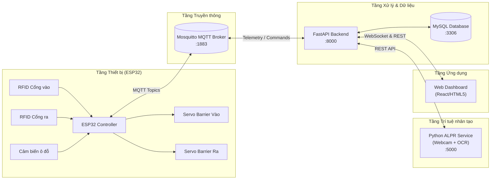

# Hệ thống Quản lý Bãi đỗ xe Thông minh (Smart Parking System)

> **Học phần**: IoT và Ứng dụng (Mã lớp học phần: `INT14149 - 09`)  
> **Học viện Công nghệ Bưu chính Viễn thông (PTIT)** - 2026  
> **Giảng viên hướng dẫn**: ThS. Kim Ngọc Bách  
> **Nhóm thực hiện**: Nhóm 08  

---

## 👥 Danh sách Thành viên & Phân công trách nhiệm

| STT | Họ và tên | Mã sinh viên | Vai trò & Trách nhiệm chính |
| :---: | :--- | :---: | :--- |
| 1 | **Nguyễn Văn Hưởng** | **B23DCCN378** | **Backend Lead**: Thiết kế CSDL MySQL, REST API (FastAPI), MQTT broker service, bảo mật JWT/RBAC, quản lý vòng đời thiết bị 10 bước, WebSocket realtime. |
| 2 | **Lê Doãn Trung** | **B23DCCN854** | **AI / ALPR Lead**: Xây dựng module nhận diện biển số xe (OpenCV + OCR), điều khiển webcam chụp theo sự kiện quẹt thẻ, gửi kết quả về Backend; viết báo cáo, slide. |
| 3 | **Đào Hoàng Thái** | **B23DCCN741** | **Embedded / Firmware Lead**: Lắp ráp mô hình vật lý; lập trình ESP32 đọc 2 RFID RC522, cảm biến siêu âm ô đỗ, điều khiển 2 Servo barrier, LCD hiển thị; MQTT client & an toàn khi mất mạng. |
| 4 | **Lê Quỳnh Anh** | **B23DCCN028** | **Frontend Lead**: Xây dựng Web Dashboard quản lý bãi xe; hiển thị trực quan sơ đồ ô đỗ thời gian thực, thông tin xe vào/ra, cảnh báo và điều khiển barrier từ xa. |

---

## 🏗️ Cấu trúc Thư mục Repository (Theo Chuẩn Đề bài)

```text
smart-parking-iot/
├── firmware/          # Mã nguồn C++/Arduino cho kit vi điều khiển ESP32
├── backend/           # Mã nguồn Backend FastAPI, xử lý MQTT, CSDL MySQL, API & WebSockets
├── frontend/          # Mã nguồn Web Dashboard giao diện người dùng
├── database/          # File schema SQL, migrations và scripts seed dữ liệu mẫu
├── deployment/        # File cấu hình Mosquitto Broker, Docker Compose và scripts khởi chạy
├── hardware/          # Sơ đồ nguyên lý nối dây (Schematic), sơ đồ khối và danh sách linh kiện
├── tests/             # Kịch bản kiểm thử chức năng, phi chức năng và mock data
├── docs/              # Bản thảo báo cáo Word, Slide thuyết trình và tài liệu thiết kế
├── .env.example       # Mẫu biến môi trường hệ thống
├── .gitignore         # Quy tắc loại trừ file nhị phân, secrets và thư viện phụ thuộc
└── README.md          # Tài liệu giới thiệu tổng quan và hướng dẫn chạy hệ thống
```

---

## ⚡ Tổng quan Kiến trúc Hệ thống



---

## 🚀 Hướng dẫn Cài đặt & Chạy Thực nghiệm

### 1. Yêu cầu Tiền đề (Prerequisites)
- **Hệ điều hành**: Windows 10/11 hoặc Linux.
- **Python**: Phiên bản 3.10 trở lên.
- **MySQL Server**: Đang chạy trên cổng mặc định `3306`.
- **Mosquitto MQTT Broker**: Đang chạy trên cổng mặc định `1883`.

### 2. Thiết lập Cơ sở dữ liệu MySQL
1. Khởi tạo cơ sở dữ liệu mới trong MySQL:
   ```sql
   CREATE DATABASE smart_parking_db CHARACTER SET utf8mb4 COLLATE utf8mb4_unicode_ci;
   ```
2. Cấu hình thông tin tài khoản MySQL vào file `.env` (copy từ `.env.example`).

### 3. Khởi chạy Backend FastAPI
```bash
cd backend
python -m venv .venv
source .venv/bin/activate  # Trên Windows: .venv\Scripts\activate
pip install -r requirements.txt
python -m app.main
```
- Swagger UI tài liệu API: `http://localhost:8000/docs`
- WebSocket Realtime endpoint: `ws://localhost:8000/ws`

### 4. Khởi chạy Dịch vụ ALPR (Camera)
```bash
cd alpr
python main.py
```

---

## 📚 Tài liệu Tham khảo & Phân tích Chi tiết
Toàn bộ tài liệu phân tích kỹ thuật, tiến độ công việc và bàn giao kiến trúc được lưu trữ tại thư mục phân tích:
- `../smart-parking-analyze/task.md`: Bảng kiểm soát tiến độ theo từng Milestone.
- `../smart-parking-analyze/PROJECT_HANDOFF.md`: Đặc tả kỹ thuật toàn diện, hợp đồng giao tiếp và ma trận bảo mật.
- `../smart-parking-analyze/architecture.md`: Bản thiết kế chi tiết luồng xử lý và các tầng kiến trúc.
